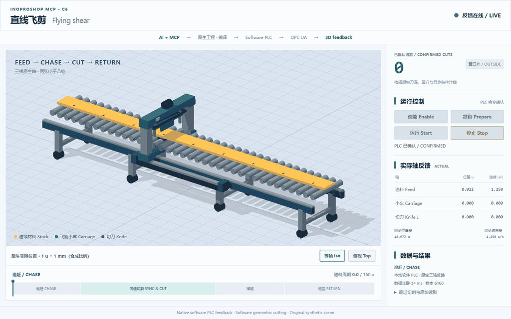

# InoProShop MCP: bring AI into PLC engineering

[中文](README.md) · English

Describe what you need in natural language, and let AI read projects, write Structured Text (ST), configure devices and tasks, and check the results with InoProShop's native compiler.

InoProShop MCP connects these engineering operations to standard MCP clients through the public ScriptEngine API, bringing code editing, project configuration, and compilation into the same conversation. Online drive parameters use a separate adapter for the locally installed CoE plugin.

[Installation and setup](#installation) · [Engineering interface](#tool-codesys_engineering) · [Servo parameters](#tool-codesys_servo) · [Build the flying shear example](#optional-build-the-flying-shear-example)

## From code to project configuration

- **Project management**: create and open projects, inspect the full object tree, make batch changes, and save; create, rename, move, and delete project objects.
- **ST development**: read existing code, edit declarations and implementations, and make targeted replacements. Work with programs, functions, function blocks, methods, properties with Get/Set, global variables, and data types such as structures and enumerations.
- **Device and task configuration**: query locally installed device descriptions, add devices, read and write device parameters, configure task cycles, priorities, and program calls, and manage libraries and variable symbols.
- **Native compilation and export**: run the InoProShop compiler and collect actual errors and warnings for AI to diagnose and correct; save projects and export software-controller boot applications.
- **Servo parameters**: online SDO reads/writes, ESI dictionary metadata, and project startup comparison, with units interpreted from the drive manual.
- **Complex motion control**: write, modify, configure, and compile ST control logic for applications such as flying shears, electronic gearing/cams, and CNC.

For example, give your AI assistant a task like this:

> Read the project structure and existing code. Add a function block with start, stop, and interlock logic, configure a cyclic task, compile and fix any diagnostics, then save the project.

## Three-axis flying shear: a complete project-building example

The repository includes original flying shear ST code and an automated project builder. Starting from a prepared blank software-controller template, it adds three virtual axes, writes the control program, configures a 10 ms cyclic task and 48 interface fields, then runs native compilation and symbol checks.

The demonstration uses actual software PLC feedback to show material feeding, carriage catch-up and synchronization, cutting, and return motion. The 3D scene makes the coordinated movement of all three axes visible.



[See how to build and run the example →](#optional-build-the-flying-shear-example)

## Hardware experience

Earlier engineering tools were used to verify project reading/writing, compilation, and downloading on our own hardware platform. The flying shear example in the current public version was verified on a software PLC.

## Installation

Requires Windows, Node.js ≥ 18, and a compatible InoProShop installation with ScriptEngine support. The engineering baseline is InoProShop 1.9.1.6 / SP11; configure device descriptions and motion components for your installed version. Python worker scripts run in the IDE's own scripting environment.

### 1. Get the tool (Git clone recommended)

```powershell
git clone https://github.com/Polarzin/Inoproshop-MCP.git
cd Inoproshop-MCP
```

If Git is not installed, [download the tool ZIP](https://github.com/Polarzin/Inoproshop-MCP/archive/refs/heads/main.zip) instead. Extract it and open PowerShell in the directory containing `package.json` and `server.mjs`. The ZIP contains the tool, required ST example files, and usage instructions; the README demonstration GIF is excluded.

### 2. Install dependencies

Run this in the tool directory:

```powershell
npm.cmd ci --ignore-scripts
```

Once dependencies are installed, the tool is ready to configure. No build step or separate Python installation is required. After updating with `git pull`, run the command above again to synchronize dependencies.

### 3. Configure your MCP client

Add a stdio service in your client's MCP settings. For clients that support the `mcpServers` JSON format, merge the configuration below. For a settings form or another configuration format, enter the corresponding command, arguments, and environment variables.

```json
{
  "mcpServers": {
    "inoproshop": {
      "command": "node",
      "args": ["C:/path/to/Inoproshop-MCP/server.mjs"],
      "env": {
        "INOPROSHOP_EXE": "C:/path/to/InoProShop.exe",
        "INOPROSHOP_PROFILE": "InoProShop(V1.9.1.6)"
      }
    }
  }
}
```

- `command`: the Node.js command. If the client cannot find `node`, use the absolute path to `node.exe`; run `(Get-Command node).Source` in PowerShell to find it.
- `args`: replace the example with the absolute path to `server.mjs` in your downloaded directory.
- `INOPROSHOP_EXE`: the absolute path to your installed `InoProShop.exe`.
- `INOPROSHOP_PROFILE`: the IDE profile name for your installation. The example uses 1.9.1.6; check the `--profile` argument in your IDE launch shortcut.

Use `/` in Windows paths within JSON, as above, or escape each backslash as `\\`.

### 4. Enable and check the connection

Save the configuration, then enable or reconnect the MCP service in your client; restart the client if needed. The appearance of `codesys_engineering` and `codesys_servo` in the tool list confirms the MCP connection. Use the examples below for calls. The client starts the service automatically, so there is no need to run `npm start` separately. A successful connection confirms MCP availability; IDE paths, profiles, and project compatibility are checked during actual engineering calls.

Close other IDE instances before normal-mode use. To coexist with an existing IDE, explicitly pass `isolated=true` in the tool arguments. Builds may take several minutes; set the client call timeout to at least 660 seconds.

## Tool: `codesys_engineering`

| `action` | Purpose |
|---|---|
| `create_empty` | Create an empty `.project` container without a controller |
| `batch` | Perform bounded read, edit, build, save, and export operations on an existing project |
| `build_c6` | Build a three-axis flying shear project from a user-prepared blank software-controller template |

Create an empty project at a nonexistent output path:

```json
{
  "action": "create_empty",
  "isolated": true,
  "project": "C:/projects/example.project"
}
```

Read the project tree and a program:

```json
{
  "action": "batch",
  "isolated": true,
  "project": "C:/projects/example.project",
  "steps": [
    {"op": "tree", "args": {}},
    {"op": "read", "args": {"path": "Application/PLC_PRG"}}
  ]
}
```

Use `tree` to discover actual object paths first. Paths use `/` separators and exact matching; the `Application/...` shorthand is accepted only when the Application is unique. Dot-separated paths and recursive same-name fallback are not supported. `read`, `create`, and `write` return full object paths for subsequent calls. Supported `batch` operations:

- Programs and structure: `tree`, `list`, `read`, `read_lines`, `patch`, `write`, `create`, `rename`, `move`, `delete`.
- Engineering: `compile`, `save`, `generate_code`, `export_boot`.
- Devices: `device`, `device_parameters`, `device_parameter_write`, `device_add`, `repository_devices`.
- Tasks and libraries: `task`, `task_configure`, `libraries`, `library_add`.
- Symbols: `symbols_create`, `symbols`, `symbol_access`, `verify_symbols`.

`write` accepts `path`, `declaration`, and `implementation`. Before modifying tasks, device parameters, or symbols, read their version/access metadata and pass back the validation fields required by the operation. See [worker_api.py](worker_api.py) for parameter definitions.

### Create and organize objects

`create` accepts `parent`, `name`, and `kind`. An empty `parent` string selects the project root.

| `kind` | Object and optional parameters |
|---|---|
| `pou` / `program` / `function` | Function block / program / function; functions accept `return_type`, defaulting to `INT` |
| `method` | Method; omit `return_type` for no return value |
| `property` | Property with Get/Set; `return_type` defaults to `INT` |
| `dut` | Data type; `dut_type` is `structure` (default), `enumeration`, `alias`, or `union`; aliases require `base_type` |
| `folder` | Project folder |
| `action` / `gvl` / `task` | Action / global variable list / task |

For example, create a function block, method, and property under an existing Application, then read the property's Get/Set paths:

```json
{
  "action": "batch",
  "isolated": true,
  "project": "C:/projects/example.project",
  "steps": [
    {"op": "create", "args": {"parent": "Application", "name": "SampleFB", "kind": "pou"}},
    {"op": "create", "args": {"parent": "Application/SampleFB", "name": "Reset", "kind": "method"}},
    {"op": "create", "args": {"parent": "Application/SampleFB", "name": "Value", "kind": "property", "return_type": "INT"}},
    {"op": "read", "args": {"path": "Application/SampleFB/Value"}}
  ]
}
```

Use `write` or `patch` on the Get/Set paths returned in `children` to edit property implementations. The property node itself has no ST implementation section. `write` accepts only sections supported by the object and returns their contents after the write.

- Rename: `rename`, with `path` and `name`.
- Move: `move`, with `path` and the destination `parent`.
- Delete: `delete`, with `path`; objects with children require explicit `recursive: true`. The result lists removed paths and GUIDs.

Object operations check name conflicts, move cycles, and readback. Compile after renaming or moving to check program references; these operations do not promise automatic refactoring of all ST references. The tool exposes predefined operations and has no arbitrary IronPython execution endpoint.

## Tool: `codesys_servo`

Uses the controller communication path saved in the project to access one EtherCAT slave through the installed native CoE service. Configure the correct communication path in the IDE, save, and close the project before calling this tool. To coexist with another IDE, use a separate project copy and `isolated=true`. Each call executes one request and closes its own IDE afterward.

| `action` | Purpose | Main arguments |
|---|---|---|
| `dictionary` | Read installed ESI names, types, bit widths, and access attributes | Filter with `query` or `index`; page with `offset` / `limit` |
| `startup` | Read the project's startup SDO list | `path`, `connector_id` |
| `read` | Upload one online SDO, returning raw bytes, decoded value, and read time | `index`, `subindex`, optional `data_type` |
| `write` | Check the current value, download one parameter, and read it back | `index`, `subindex`, `data_type`, `value`, `expected_raw_hex`, `expected_address` |

Every operation requires an absolute `.project` path in `project` and the exact device path in `path`. `connector_id` defaults to `"1"`; use the actual device configuration. Pass indices as decimal integers, for example `0x609A = 24730`. To read a drive's homing acceleration object:

```json
{
  "action": "read",
  "project": "C:/projects/machine.project",
  "path": "Device/EtherCAT/Drive",
  "index": 24730,
  "subindex": 0,
  "data_type": "UDINT"
}
```

Change `action` to `dictionary` to inspect that object's ESI definition, or to `startup` to read the project's startup list and compare matching `index/subindex` entries. ESI defaults and startup values are project configuration, not online values. Receipts identify their scope with `scope` and `online_verified`.

The write request has the following shape. Replace the placeholders with `raw_hex` and `configured_address` from a successful read, and the intended target value. `configured_address` is the IDE's native communication route address, not the PLC's IP address:

```json
{
  "action": "write",
  "project": "C:/projects/machine.project",
  "path": "Device/EtherCAT/Drive",
  "index": 24730,
  "subindex": 0,
  "data_type": "UDINT",
  "value": "<target numeric value>",
  "expected_raw_hex": "<raw_hex returned by read>",
  "expected_address": "<configured_address returned by read>"
}
```

Supported types: `BOOL`, `SINT/USINT`, `INT/UINT`, `DINT/UDINT`, `LINT/ULINT`, `REAL/LREAL`, and `BYTE/WORD/DWORD/LWORD`. Supply write values as strings to preserve 64-bit integer precision. Raw bytes use little-endian order; the type must agree with the device definition.

Interpret units using the drive manual and actual scaling parameters. Units absent from the ESI are `null`; the tool does not treat counts as millimetres. For homing speed and acceleration, also establish whether the controller performs host homing or drive homing before concluding that the setting governs the current motion.

For example, the [Leadshine CL3C V1.9 manual](https://www.leisai.com/upload/file/2025/04/09/0aa0ac03-2eac-40f9-a37f-b9ec218c72bf.pdf) defines `2000:00` as peak current in 0.1 A counts, `6099:01/02` in command pulses/s, `609A:00` in command pulses/s², and `2001:00` / `6092:01` as command pulses per revolution (PDF pages 30, 97, 109–110). These units are device-specific; changes to `2001` take effect after restart.

`write` changes the selected online object. It does not save the project, download the PLC application, or send additional start, stop, reset, motion, or nonvolatile-storage commands. The selected object itself determines immediate, restart-dependent, or stored effects and side effects according to the drive definition. Failure receipts preserve native errors and readback status; no request is retried automatically. A client timeout does not cancel the native operation. Inspect that call's `var/` result before deciding the next action.

The online adapter targets **InoProShop 1.9.1.6 / SP11**, using reflection to call CoE interfaces in locally installed plugins. Compatibility with other versions is not established. Only adapter code is included; users install vendor plugins separately.

Offline regression without an IDE: `npm test`. With Python 3, `python -m unittest discover -s tests -p "test_servo*.py" -v` covers the shared parameter API and finite worker, including project preservation on successful, failed, and exceptional servo requests. Native online-read acceptance and physical write acceptance are separate; isolated tests do not establish physical write acceptance.

Normal sessions use the current user's configured gateway. A fresh `isolated=true` profile also needs the gateway referenced by the project; missing configuration returns a connection error without changing the target. On 2026-11-14, a real MCP read passed from a cold IDE using the normal gateway, with the project copy's hash unchanged. Validation includes 29 isolated Python tests, 3 MCP/Node tests and one focused independent review. Writes were tested with fake native interfaces, not on physical drives.

## Optional: build the flying shear example

Prepare a blank software-controller template using the official IDE or public ScriptEngine. It must contain `Device`, one `Application`, `MainTask`, `SoftMotion General Axis Pool`, and an empty `PLC_PRG`, with IDE Simulation disabled. Do not prepopulate example axes or a flying shear program.

The builder requires the SoftMotion Win software target `4102 / 0000 0001`; the existing baseline version is `3.5.11.10`. The virtual-axis description must match the local installation; query `repository_devices` if needed.

```json
{
  "action": "build_c6",
  "isolated": true,
  "template": "C:/templates/blank-softmotion.project",
  "project": "C:/projects/flying-shear.project",
  "axis": {"type": 1024, "id": "FFFF 0001", "version": "4.0.0.0"}
}
```

The tool copies the template to a new path, adds three virtual axes, the included ST, a 10 ms task, and 48 interface fields, then runs the native compiler and symbol checks. The source template is preserved; existing output files are rejected. The three original files in `examples/c6/` are runtime dependencies for this action.

To export a boot application, run `batch` on the generated project with the step `{"op":"export_boot","args":{}}`. This operation accepts software controllers only and produces native `Application.app/.crc` files. Deploy and run using the official software workflow.

## Usage notes

- `codesys_engineering` performs offline engineering operations. `codesys_servo` uses `read/write` for online drive parameters and `dictionary/startup` for project metadata.
- Local results and the lock are stored under `var/`. Failed batches are not automatically replayed. If a timeout leaves the outcome unknown, inspect the IDE and the result referenced by `var/engineering.lock`; resolve the lock only after confirming its IDE has closed.
- Project creation and template builds require new output paths. `batch` saves changes to existing projects; `codesys_servo` does not save projects.
- Obtain vendor software, device descriptions, motion components, native project templates, and licenses from official sources.

## License

Independently developed. Original tool code and synthetic ST are [MIT licensed](LICENSE). See [NOTICE](NOTICE.md) for third-party dependencies and interoperability information.

API reference: [CODESYS ScriptEngine documentation](https://content.helpme-codesys.com/en/ScriptingEngine/index.html).

Try it out, open an issue, or contribute.
