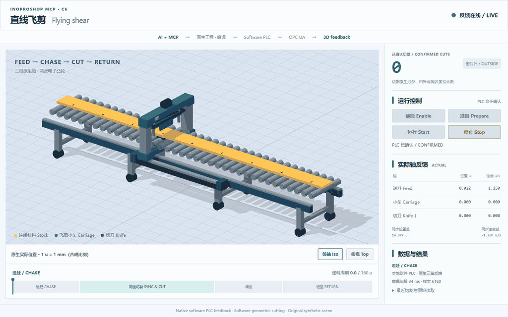

# InoProShop MCP：让 AI 参与 PLC 工程开发

中文 · [English](README.en.md)

用自然语言描述需求，让 AI 在 InoProShop 中读取工程、编写 ST 程序、配置设备与任务，再调用原生编译器检查结果。

InoProShop MCP 通过公开 ScriptEngine 接口，将这些工程操作接入标准 MCP 客户端，让程序编辑、工程配置和编译检查可以在同一段对话中完成；在线驱动参数另由本机 CoE 插件适配器提供。

[安装与配置](#安装) · [工程接口](#工具codesys_engineering) · [伺服参数](#工具codesys_servo) · [构建飞剪示例](#可选构建飞剪示例)

## 从程序到工程，覆盖常用开发操作

- **工程管理**：创建和打开工程，查看完整对象树，批量修改与保存；支持工程对象的创建、重命名、移动和删除。
- **ST 程序开发**：读取现有代码，修改声明与实现，按需局部替换；支持程序、函数、功能块、方法、属性及 Get/Set，以及全局变量和结构体、枚举等数据类型。
- **设备与任务配置**：查询本机设备描述、添加设备、读写设备参数，配置任务周期、优先级与程序调用，管理依赖库和变量符号。
- **原生编译与导出**：调用 InoProShop 编译器，获取实际错误与警告，供 AI 定位问题、继续修改；支持保存工程和导出软件控制器启动包。
- **伺服参数调试**：在线 SDO 读写、ESI 参数字典和工程启动值对照，按驱动手册解释单位。
- **复杂运动控制**：支持飞剪、电子齿轮／凸轮、CNC 等应用中 ST 控制程序的编写、修改、工程配置与编译。

例如，可以直接交给 AI 这样的任务：

> 先读取工程结构和现有程序，新增一个带启动、停止和互锁逻辑的功能块，配置周期任务，编译并根据诊断修正，最后保存工程。

## 三轴飞剪：一个完整的工程构建实例

仓库附带原创三轴飞剪 ST 示例和自动构建工具。从准备好的空白软件控制器模板开始，自动添加三根虚拟轴、写入飞剪程序、配置 10 ms 周期任务与 48 个接口字段，完成原生编译和符号检查。

配套演示采用软件 PLC 的实际运行反馈，呈现送料、小车追赶与同步、切刀动作及回程。通过 3D 场景，可以直观看到程序驱动下的三轴协同过程。



[查看构建与运行方法 →](#可选构建飞剪示例)

## 硬件实践

前期工程工具已在自有硬件平台上验证过工程读写、编译与下载操作。当前公开版的三轴飞剪示例在软件 PLC 上验证。

## 安装

需要 Windows、Node.js ≥ 18 和带有 ScriptEngine 的兼容 InoProShop。工程接口基线为 InoProShop 1.9.1.6 / SP11；设备描述和运动组件按本机安装版本配置。Python 工作脚本由 IDE 自带的脚本环境执行。

### 1. 获取工具（推荐 Git clone）

```powershell
git clone https://github.com/Polarzin/Inoproshop-MCP.git
cd Inoproshop-MCP
```

没有安装 Git 时，也可[下载工具 ZIP](https://github.com/Polarzin/Inoproshop-MCP/archive/refs/heads/main.zip)。解压后，在包含 `package.json` 和 `server.mjs` 的目录打开 PowerShell。ZIP 包含工具、必要 ST 示例和使用说明，排除 README 展示动图。

### 2. 安装依赖

在工具目录运行：

```powershell
npm.cmd ci --ignore-scripts
```

依赖安装完成即可配置使用，无需构建，也无需单独安装 Python。以后通过 `git pull` 更新工具后，再运行一次上述命令同步依赖。

### 3. 配置 MCP 客户端

在客户端的 MCP 设置中添加一个 stdio 服务。支持 `mcpServers` JSON 格式的客户端可合并以下配置；使用表单或其他配置格式时，填写对应的命令、参数和环境变量。

```json
{
  "mcpServers": {
    "inoproshop": {
      "command": "node",
      "args": ["C:/path/to/Inoproshop-MCP/server.mjs"],
      "env": {
        "INOPROSHOP_EXE": "C:/path/to/InoProShop.exe",
        "INOPROSHOP_PROFILE": "InoProShop(V1.9.1.6)"
      }
    }
  }
}
```

- `command`：Node.js 启动命令。客户端找不到 `node` 时，填入 `node.exe` 的绝对路径，可在 PowerShell 中运行 `(Get-Command node).Source` 查询。
- `args`：将示例路径替换为下载目录内 `server.mjs` 的绝对路径。
- `INOPROSHOP_EXE`：本机 `InoProShop.exe` 的绝对路径。
- `INOPROSHOP_PROFILE`：本机实际安装的 IDE profile 名称；示例对应 1.9.1.6，可在 IDE 启动快捷方式的 `--profile` 参数中核对。

JSON 中的 Windows 路径建议使用 `/`，如上例；使用反斜杠时需写成 `\\`。

### 4. 启用并确认连接

保存配置后，在客户端启用或重新连接该 MCP 服务；必要时重启客户端。工具列表中出现 `codesys_engineering` 和 `codesys_servo` 即表示 MCP 已连接，后续按下方示例调用。服务由客户端自动启动，无需另外运行 `npm start`。连接成功只表示 MCP 可用；IDE 路径、profile 和工程兼容性会在实际工程调用时检查。

普通模式使用前关闭其他 IDE。需要与已有 IDE 并存时，在工具参数中显式设置 `isolated=true`。构建可能需要数分钟，客户端调用超时应至少为 660 秒。

## 工具：`codesys_engineering`

| `action` | 用途 |
|---|---|
| `create_empty` | 创建空 `.project` 容器，尚无控制器 |
| `batch` | 对已有工程执行有限的读取、编辑、编译、保存和导出操作 |
| `build_c6` | 从用户准备的空白软件控制器模板构建三轴飞剪工程 |

创建空工程，输出路径必须不存在：

```json
{
  "action": "create_empty",
  "isolated": true,
  "project": "C:/projects/example.project"
}
```

读取工程树与程序：

```json
{
  "action": "batch",
  "isolated": true,
  "project": "C:/projects/example.project",
  "steps": [
    {"op": "tree", "args": {}},
    {"op": "read", "args": {"path": "Application/PLC_PRG"}}
  ]
}
```

先通过 `tree` 获取实际对象路径。路径使用 `/` 分隔并精确匹配；`Application/...` 简写仅在 Application 唯一时可用。不支持点分隔路径或递归同名回退。`read`、`create`、`write` 返回完整对象路径，后续调用可直接复用。`batch` 可用操作包括：

- 程序与结构：`tree`、`list`、`read`、`read_lines`、`patch`、`write`、`create`、`rename`、`move`、`delete`。
- 工程：`compile`、`save`、`generate_code`、`export_boot`。
- 设备：`device`、`device_parameters`、`device_parameter_write`、`device_add`、`repository_devices`。
- 任务与库：`task`、`task_configure`、`libraries`、`library_add`。
- 符号：`symbols_create`、`symbols`、`symbol_access`、`verify_symbols`。

`write` 使用 `path`、`declaration` 和 `implementation`。修改任务、设备参数或符号前，先读取对应版本/权限信息，并传回操作要求的校验字段。各操作参数定义见 [worker_api.py](worker_api.py)。

### 对象创建与整理

`create` 使用 `parent`、`name`、`kind`；`parent` 为空字符串时表示工程根节点。

| `kind` | 对象与可选参数 |
|---|---|
| `pou` / `program` / `function` | 功能块 / 程序 / 函数；函数可指定 `return_type`，默认 `INT` |
| `method` | 方法；可指定 `return_type`，省略表示无返回值 |
| `property` | 属性及 Get/Set；`return_type` 默认 `INT` |
| `dut` | 数据类型；`dut_type` 为 `structure`（默认）、`enumeration`、`alias` 或 `union`；别名类型需 `base_type` |
| `folder` | 工程文件夹 |
| `action` / `gvl` / `task` | 动作 / 全局变量列表 / 任务 |

例如，在已有 Application 中创建功能块、方法和属性，读取属性的 Get/Set 路径：

```json
{
  "action": "batch",
  "isolated": true,
  "project": "C:/projects/example.project",
  "steps": [
    {"op": "create", "args": {"parent": "Application", "name": "SampleFB", "kind": "pou"}},
    {"op": "create", "args": {"parent": "Application/SampleFB", "name": "Reset", "kind": "method"}},
    {"op": "create", "args": {"parent": "Application/SampleFB", "name": "Value", "kind": "property", "return_type": "INT"}},
    {"op": "read", "args": {"path": "Application/SampleFB/Value"}}
  ]
}
```

对返回的 `children` 中 Get/Set 路径执行 `write` 或 `patch` 可编辑属性实现；属性节点本身没有 ST 实现段。`write` 只接受对象实际具有的声明/实现段，并返回写后内容。

- 重命名：`rename`，参数 `path`、`name`。
- 移动：`move`，参数 `path`、目标 `parent`。
- 删除：`delete`，参数 `path`；有子对象时需显式传入 `recursive: true`，结果列出删除的路径和 GUID。

创建或整理对象时会检查目标重名、移动环路和写后结果。重命名、移动后请编译检查程序引用；接口不承诺自动重构所有 ST 引用。工具仅提供固定操作，不提供任意 IronPython 脚本执行入口。

## 工具：`codesys_servo`

沿用工程中保存的控制器通信路径，通过原厂 CoE 服务访问指定 EtherCAT 从站。先在 IDE 中配置正确的通信路径、保存并关闭工程，再调用此工具；与其他 IDE 并存时使用独立工程副本和 `isolated=true`。每次调用只执行一个请求，结束后关闭自有 IDE。

| `action` | 用途 | 主要参数 |
|---|---|---|
| `dictionary` | 读取已安装 ESI 的名称、类型、位宽与访问属性 | `query` 或 `index` 筛选，`offset` / `limit` 分页 |
| `startup` | 读取工程中的启动 SDO 列表 | `path`、`connector_id` |
| `read` | 在线上传一个 SDO，返回原始字节、解码值和读取时间 | `index`、`subindex`，可选 `data_type` |
| `write` | 检查当前值后下载一个参数，并在线回读 | `index`、`subindex`、`data_type`、`value`、`expected_raw_hex`、`expected_address` |

所有操作都要求 `.project` 绝对路径 `project` 和设备完整路径 `path`；`connector_id` 默认 `"1"`，以设备配置为准。索引传十进制整数，如 `0x609A = 24730`。例如读取驱动的回零加速度对象：

```json
{
  "action": "read",
  "project": "C:/projects/machine.project",
  "path": "Device/EtherCAT/Drive",
  "index": 24730,
  "subindex": 0,
  "data_type": "UDINT"
}
```

将 `action` 改为 `dictionary` 可查这个对象的 ESI 定义；改为 `startup` 可读工程启动列表，再按 `index/subindex` 对照在线结果。ESI 默认值和启动列表都属于工程配置，不能代替在线值。`scope` 和 `online_verified` 标明回执范围。

写入参数结构如下；占位内容须替换为刚才成功读取返回的 `raw_hex`、`configured_address` 及已经确定的目标数值。`configured_address` 是 IDE 原生通信路由地址，不是 PLC IP：

```json
{
  "action": "write",
  "project": "C:/projects/machine.project",
  "path": "Device/EtherCAT/Drive",
  "index": 24730,
  "subindex": 0,
  "data_type": "UDINT",
  "value": "<目标数值>",
  "expected_raw_hex": "<read 返回的 raw_hex>",
  "expected_address": "<read 返回的 configured_address>"
}
```

支持 `BOOL`、`SINT/USINT`、`INT/UINT`、`DINT/UDINT`、`LINT/ULINT`、`REAL/LREAL` 和 `BYTE/WORD/DWORD/LWORD`。写入数值用字符串传递，避免 64 位整数在 JSON 中丢失精度。原始字节按小端序解释，类型应与设备定义一致。

单位依据驱动手册和实际标度参数解释；ESI 未提供的单位返回 `null`，工具不会把计数直接当作毫米。对回零速度、加速度等对象，还须确认控制器采用主站回零还是驱动器回零，才能判断该设值是否参与当前运动。

例如，[雷赛 CL3C 手册 V1.9](https://www.leisai.com/upload/file/2025/04/09/0aa0ac03-2eac-40f9-a37f-b9ec218c72bf.pdf)的 `2000:00` 是峰值电流设定（每计数 0.1 A），`6099:01/02` 为指令脉冲/s，`609A:00` 为指令脉冲/s²，`2001:00` 与 `6092:01` 为每转指令脉冲数。对应 PDF 第30、97、109–110页；这些单位不能直接套用到其他驱动，`2001` 修改后需重启生效。

`write` 会改变所选在线对象，不保存工程、不下装 PLC，也不额外发送启停、复位、运动或非易失存储命令。所选对象本身的即时、重启或存储生效方式和副作用按驱动定义。失败回执保留原生错误及读回状态；无自动重试。调用端超时不取消原生请求，应先检查本次 `var/` 结果，确认结果后再决定下一步。

在线适配基线为 **InoProShop 1.9.1.6 / SP11**，通过反射调用本机安装插件的 CoE 接口；不是跨版本 ScriptEngine 通用承诺。仓库仅包含适配代码，厂商插件由使用者自行安装。

正常会话使用当前用户已配置的网关。`isolated=true` 的全新用户目录也须具有工程所引用的网关；缺失时返回连接错误，不自动改通信目标。2026-11-14 已验证正常用户网关下真实 MCP 冷启动读取，工程副本哈希未变；29 项 Python 隔离测试、3 项 MCP/Node 测试和聚焦独审通过。写入使用假原生接口验证，未进行现场写参。

离线回归（不启动 IDE）：`npm test`；可选 Python 3 执行 `python -m unittest discover -s tests -p "test_servo*.py" -v`，覆盖共享参数 API 与有限 worker，包括成功、失败和异常时均不保存工程。实际在线读取与真实写参验收分别报告，隔离测试不代替现场写参验收。

## 可选：构建飞剪示例

通过官方 IDE 或公开 ScriptEngine 准备空白软件控制器模板，包含 `Device`、一个 `Application`、`MainTask`、`SoftMotion General Axis Pool` 和空 `PLC_PRG`，关闭 IDE Simulation 模式。不预置示例轴或飞剪程序。

构建器要求 SoftMotion Win 软件目标 `4102 / 0000 0001`；已有基线版本为 `3.5.11.10`。虚拟轴描述必须与本机安装匹配，可先通过 `repository_devices` 查询。调用示例：

```json
{
  "action": "build_c6",
  "isolated": true,
  "template": "C:/templates/blank-softmotion.project",
  "project": "C:/projects/flying-shear.project",
  "axis": {"type": 1024, "id": "FFFF 0001", "version": "4.0.0.0"}
}
```

工具复制模板到新路径，添加三根虚拟轴、随附 ST、10 ms 任务和 48 个接口字段，执行原生编译与符号检查。源模板保持不变，已有输出不覆盖。`examples/c6/` 中三份原创文件是此操作的运行依赖。

需要导出启动包时，对生成的工程执行 `batch`，步骤为 `{"op":"export_boot","args":{}}`。该操作仅接受软件控制器，输出原生 `Application.app/.crc`。部署与运行通过官方软件流程完成。

## 使用说明

- `codesys_engineering` 执行离线工程操作；`codesys_servo` 的 `read/write` 访问在线驱动参数，`dictionary/startup` 读取工程元数据。
- 本地结果和锁保存在 `var/`。失败不自动重发；超时结果未知时先检查 IDE 与 `var/engineering.lock` 所指的结果，确认对应 IDE 已关闭后再处理锁。
- 工程创建与模板构建要求新输出路径；`batch` 会保存对已有工程的修改，`codesys_servo` 不保存工程。
- 厂商软件、设备描述、运动组件、原生工程模板和许可由使用者从官方来源取得。

## 许可

个人独立开发，自有工具代码与合成 ST 采用 [MIT](LICENSE)。第三方依赖和互操作说明见 [NOTICE](NOTICE.md)。

接口依据：[CODESYS ScriptEngine 文档](https://content.helpme-codesys.com/en/ScriptingEngine/index.html)。

欢迎试用、提 Issue 和参与贡献。
